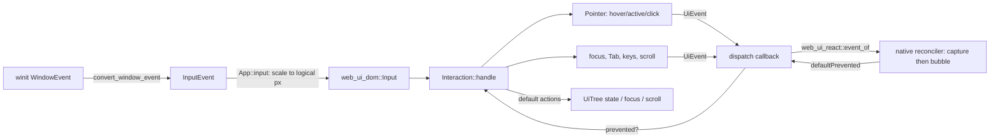

# Input and events

Crates: [platypus_platform](../crates/platypus_platform/src) (OS input) and the glue in
[platypus_app/main.rs](../crates/platypus_app/src/main.rs). The UI side (hit testing, `Pointer`, `Interaction`, cursor
keywords, dialogs, scrolling, text fields, drag and drop, and the script side's events) is in web-ui: web-ui
`docs/input-and-events.md`. Test plan: M3-EVT-* in [TESTS.md](../TESTS.md).

## End to end

## Platform layer

[input.rs](../crates/platypus_platform/src/input.rs) converts winit's `WindowEvent` to Platypus's own
`InputEvent` so nothing above this crate depends on winit:

- Keys use DOM naming: `code` is the physical key (`"KeyW"`, from winit's `KeyCode` debug name),
  `key` is the layout meaning (`dom_key`: characters as typed, `Space` -> `" "`, `Super` -> `"Meta"`,
  other named keys by their name), `text` is the typed text without control characters, plus `repeat`.
  `convert_key` is split out because winit's `KeyEvent` cannot be built in tests.
- Mouse: `MouseMove{x,y}` in **physical** pixels, `MouseDown/Up{button}`, `MouseLeave`, and
  `MouseWheel(WheelDelta)`. winit's wheel deltas are positive when scrolling up; the code negates
  them to the DOM convention (positive y = scroll down). `Lines` (notched wheels) and `Pixels`
  (touchpads) stay distinct.
- `Ime(ImeEvent)` for input methods: `Enabled`, `Preedit(text, cursor)` (cursor/selection as byte
  offsets, `None` hides the caret, empty text ends composing), `Commit(text)`, `Disabled`. winit only
  sends these after the app calls `set_ime_allowed(true)` (see below).
- `Modifiers`, `Resized`, `Focused`, `CloseRequested`.
- `MouseMotion { dx, dy }`: raw device movement from winit's `device_event`
  (`DeviceEvent::MouseMotion`). It is not clamped by the window's edges and keeps coming while the
  cursor is locked, which is what mouse look needs. `Platform` forwards it to `PlatformApp::input`.
- `WindowConfig.icon` (RGBA, width, height) becomes the window icon (`with_window_icon`);
  `CursorGrabMode` and `Icon` are re-exported for the app.
- `Gamepad { id, event: GamepadEvent }` (see [Gamepads](#gamepads-and-game-input-m3c-step-6)).

[platform.rs](../crates/platypus_platform/src/platform.rs): `Platform::run` owns the winit event loop.
`Runner` implements `ApplicationHandler`: creates the window in `resumed` (then
`PlatformApp::window_ready`), calls `PlatformApp::frame` on `RedrawRequested`, forwards converted
events to `PlatformApp::input`, and in `about_to_wait` checks `should_exit`, polls gamepads and
requests the next redraw (continuous rendering). `Platform::poll_gamepads` drains `gilrs` and
returns `InputEvent::Gamepad`s, which the runner feeds to `PlatformApp::input` like any other
event. `platypus_platform` re-exports `winit::dpi` so the app can build
IME area arguments.

Custom cursors need the event loop, so the app asks for them instead of creating them:
`PlatformApp::take_custom_cursor` (default `None`) returns a `CustomCursorRequest { key, image:
Option<CursorRgba> }`. The runner calls it after each frame, each input event and `about_to_wait`
(`Runner::update_cursor`). The first time it sees a `key` it builds a winit `CustomCursor` from the
RGBA pixels and hotspot (`CursorRgba`) and caches it in `cursors`; later requests with the same key
need no `image`. A rejected image is logged and skipped.

## App glue ([main.rs](../crates/platypus_app/src/main.rs))

`App::input` maps `InputEvent` to `web_ui_dom::Input` and calls `handle_ui`:

- Positions are divided by `App::scale()`, the window DPI factor times the UI scale ([UI scale](#ui-scale)). `Lines` wheel deltas are
  multiplied by `WHEEL_LINE` (40 px), touchpad pixels are divided by scale.
- Buttons become DOM numbers via `dom_button` (0 left, 1 middle, 2 right, 3/4 back/forward).
  `PointerDown` carries `time_ms` (engine clock) for double-click detection.
- `Focused(false)` becomes `Input::WindowBlur`, so buttons held while the window was unfocused
  are forgotten (their release may never arrive).
- `handle_ui` calls `Interaction::handle(tree, input, &mut |event| dispatch(...))`, then
  `update_cursor`, which reads `Interaction::cursor_with_images` and acts only when the keyword,
  the image list or the window scale changed. It tries the `cursor: url(...)` images in order: the
  file is read from the game folder or a `data:` URL, decoded and cached by `url@scale`
  (`cursors_loaded`; `cursors_failed` warns once and moves on to the next image). The first that
  works becomes `custom_cursor` for the platform (see [Platform layer](#platform-layer)). With none,
  it falls back to the keyword (`set_cursor_visible(false)` for `none`; otherwise winit's
  `CursorIcon`). [cursor.rs](../crates/platypus_app/src/cursor.rs) decodes PNG, JPEG and `.cur` (an
  `.ico` of type 2 whose hotspot sits where `.ico` keeps colour planes). The hotspot is the CSS one,
  else the file's own, else the top-left corner. Images are scaled for the window's DPI and ones
  over `MAX_CURSOR_SIZE` (128px) are rejected.
- The native backend (`native.rs`) turns each `UiEvent` into an `Event` with `web_ui_react::event_of` and runs the
  compiled handlers (capture then bubble); it returns `true` only if a handler called `preventDefault()`. If the game
  has no handlers, nothing is dispatched but built-in behaviour (hover, focus, Tab) still works. (The QuickJS
  `__platypus_ui_event` call is gone; `UiEvent::script_args()` stays as the shared payload layout.)
- `KeyDown` forwards `text` (what the key types). `InputEvent::Ime` becomes `Input::ImePreedit` or
  `Input::ImeCommit`; `Ime::Disabled` becomes an empty `ImePreedit` (ends composing).
- After each `handle_ui`, `Interaction::take_clipboard()` is serviced and `update_ime` runs (see
  web-ui `docs/input-and-events.md`, "Text fields"); `frame()` also calls `UiTree::set_time(now_ms)` (caret
  blink) and `update_ime` (the caret may have moved with layout).
- Script requests `focus`, `blur`, `scrollTo`, `scrollBy`, `scrollIntoView` (a behavior string as 4th arg) become
  `Input::Focus/Blur/ScrollTo/ScrollBy/ScrollIntoView` in `App::tick`. At the end of each tick the app sends `Input::Refresh`.

### Script cursor (M5.a2)

Scripts' `Cursor` (Unity's names; the native `Cursor` API of `platypus_engine_api`) sets a `ScriptCursor { visible, lock, image }`
through the `cursor.*` requests of `App::cursor_op`:

- `cursor.visible bool` hides or shows the OS cursor over the window.
- `cursor.lock none|locked|confined` calls `set_cursor_grab` (`apply_cursor_lock`). `Locked` hides the
  cursor, and falls back to `Confined` where the platform cannot lock (Windows only confines). The
  grab is re-applied when the window regains focus.
- `cursor.image src|null [hotspot x y]` is the default cursor image, in the same formats and limits as
  CSS cursor images.

`update_cursor` combines them with the UI: `shown = script_cursor.visible && lock != Locked`, and the
script's image is used only where the UI asks for nothing special (no `cursor: url(...)` images and the
keyword `default`). A CSS `cursor` on an element always wins; `cursor: none` still hides it. Any
`cursor.*` op clears the cached cursor so the change shows at once.

## Gamepads and game input (M3c step 6)

### Gamepads
[gamepad.rs](../crates/platypus_platform/src/gamepad.rs) turns `gilrs` events into
`InputEvent::Gamepad { id, event }`; `id` is stable while the pad is connected. `GamepadEvent` is
`Connected { name }`, `Disconnected`, `ButtonDown(name)`, `ButtonUp(name)`, `ButtonValue(name, 0..1)`
(analog triggers) and `Axis(name, -1..1)`. `Platform::poll_gamepads` announces pads already plugged in
at its first poll (some `gilrs` backends send no `Connected` for them); `announce_once` drops a repeat
`Connected` for a known pad and forgets pads on `Disconnected` (`M3-PAD-02`). Pads present at startup and newly connected ones are logged at info level (`log_pad`: name, vendor/product id, uuid hex). gilrs warns "No mapping found for UUID 0000..." for pads from Windows' gaming input (WGI) backend, such as Xbox controllers, which report an all-zero UUID; it is harmless, the driver provides the layout (`mapping_source()` is `Driver`). Names are fixed strings so scripts do not depend on
`gilrs`:

- Buttons (`button_name`): `South` (A), `East` (B), `West` (X), `North` (Y), `LeftBumper`,
  `RightBumper`, `LeftTrigger`, `RightTrigger`, `Select`, `Start`, `Mode`, `LeftStick`,
  `RightStick` (clicks), `DPadUp/Down/Left/Right` (plus `C`, `Z`).
- Axes (`axis_name`): `LeftStickX/Y`, `RightStickX/Y`, `LeftZ`, `RightZ`, `DPadX/Y`. Sticks are
  **y-up**: up and right are positive.
- Unknown buttons/axes, repeats, dropped events and force-feedback notices are ignored
  (`convert_gamepad` returns `None`).

### To scripts
`App::input` handles `Gamepad` events first and returns early. It gives them to the native backend
(`Native::game_input`) with the layout of `game_input::script_args(id, event)`
([game_input.rs](../crates/platypus_app/src/game_input.rs)); the `__platypus_input` JS call is gone:

| Event | Arguments |
|---|---|
| connected | `"gamepadconnected", id, name` |
| disconnected | `"gamepaddisconnected", id` |
| button down / up / analog | `"gamepadbutton", id, button, value` (1, 0, or 0..1) |
| axis | `"gamepadaxis", id, axis, value` |
| key down | `"keydown", code, key, repeat` |
| key up | `"keyup", code, key` |
| window lost focus | `"blur"` |

Key events are forwarded after the UI has handled them, **except while a text field has focus**
(`UiTree::is_editor`): typed keys stay the field's. Focus loss always sends `blur`.

### `input` (native API)
The native `input` of `platypus_engine_api` (the `input.ts` of `@platypus/engine` is deleted) keeps the state:

- `input.isKeyDown(code)` by physical `code` (`"KeyW"`).
- `input.gamepads()`, `input.gamepad(id)`: connected pads as `Gamepad { id, name, connected,
  buttons, axes }` (button values 0..1, axis values -1..1).
- `input.isButtonDown(name)`: any connected pad holds it (value above 0.5).
- `input.on(type, fn)` returns an unsubscribe function. Types: `keydown`, `keyup`,
  `gamepadconnected`, `gamepaddisconnected`, `gamepadbuttondown`, `gamepadbuttonup` (fired when a
  value crosses 0.5), `gamepadaxis`. A throwing listener is logged and the rest still run. The event fields are `InputEvent` (see `platypus-api.md`).
- `blur` clears held keys and zeroes pad buttons, since the releases may never arrive.

### The mouse for gameplay (M5.a2)

`App::input` also sends the mouse to the game's `input`, **before** and whatever the UI
does with it (so game code sees clicks over UI too; check the UI state yourself if that matters):

| Event | Arguments |
|---|---|
| move | `"mousemove", x, y` (UI pixels: window pixels divided by `App::scale()`) |
| button down / up | `"keydown", "MouseLeft" \| "MouseRight" \| "MouseMiddle" \| "Mouse<n>", "", false` and `"keyup", code, ""` |
| wheel | `"wheel", dx, dy` in lines (touchpad pixels divided by 40, about a line per 40 px like browsers) |
| raw motion | `"mousedelta", dx, dy` (only while the window has focus: `App::focused`) |

Raw `MouseMotion` events return after this and never reach the UI. Mouse buttons are ordinary keys in
the script's key state, so `input.isKeyDown("MouseLeft")` works.

The `input` state keeps `mousePosition`, and accumulates `mousedelta` and `wheel`
into pending sums that roll over once per tick with the key press sets, so `mouseDelta` and
`mouseScrollDelta` are this tick's totals. `mouseDelta` has y **up** positive (raw device y is down).
`getMouseButton(n)`, `getMouseButtonDown(n)` and `getMouseButtonUp(n)` use Unity's numbers (0 left,
1 right, 2 middle). `getAxis("Mouse X")` and `"Mouse Y"` are the delta times `0.1` (Unity's default
sensitivity), and `"Mouse ScrollWheel"` is the wheel's y times `0.1`. Lock the cursor with
`Cursor.lockState` for mouse look ([above](#script-cursor-m5a2)).

### UI navigation
`GamepadNav::ui_input(id, event)` in `game_input.rs` maps pad events to UI `Input`s: d-pad buttons
-> `Input::Navigate(Direction)`, `South` -> `Input::Activate`, and the left stick to `Navigate`
with hysteresis (pushed at |v| >= 0.6, released below 0.3, so one push moves once; the y axis is
up-positive; state is per pad and axis and dropped on disconnect). The app only sends these to
`handle_ui` while `Interaction::focused()` is set, so the d-pad stays the game's until UI takes
focus (e.g. a menu calling `ref.focus()`). The event is still sent to the game's `input` either way.

`nearest_in_direction(tree, from, direction)` (web-ui's `crates/web_ui_dom/src/interaction.rs`)
considers the elements in `tab_order`, keeps those whose centre lies that way (more than 0.5 px
along the direction) and scores `along + 2 * |across|`, so elements in line beat closer ones off to
the side. The lowest score wins; there is no wrap-around.

## UI scale

Screen UI is laid out in UI pixels and drawn bigger or smaller (s&box's ScreenPanel scaling), so a design for one
size fills any window the same. Games pick a mode with `UiScale` (`platypus_engine_api::ui_scale`, a
`#[ts_api]` namespace): `UiScale.none()` (the default: one UI pixel per logical pixel), `UiScale.fixed(f)`,
`UiScale.height(1080)` (the window is that many UI pixels high) or `UiScale.fit(1920, 1080)` (that design fits inside
the window). A zero, negative or NaN size is ignored. The factor is clamped to 0.25..8 and is 1 for a minimised window.

The host reads the mode each time it sizes the screen (`ui_factor_for` in `main.rs`: the DPI scale times
`UiScale::factor` of the logical window size) on all three renderers (wgpu, GLES `gles_gfx.rs`, CPU `cpu_gfx.rs`);
`App::scale()` uses it for the layout size, the render target's `scale`, pointer and wheel positions and the IME
cursor area, and `Screen.width` / `height` are in UI pixels. A hot reload starts the new code unscaled (its top level
may set it again); a failed reload keeps the old code's. Tests `M3-GAME-02`, `M9-TS-3388`.
